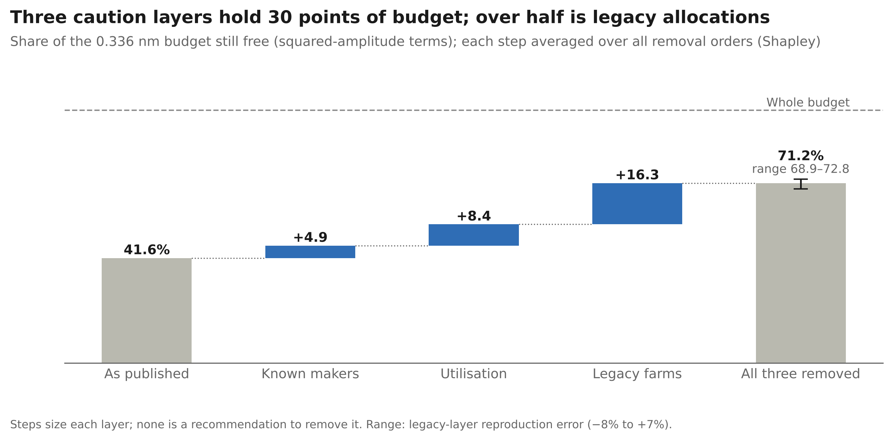

# The budget that used to be a probability

Code and data for the article **"The budget that used to be a probability: 21 years of statistics at Eskdalemuir"**
(Ridhima Gupta, 2026).

Wind turbines within 50 km of the Eskdalemuir seismic array in southern Scotland share a vibration budget of
0.336 nm. This repository independently reproduces the 2026 calculation published in the UK government's
consultation, and computes every number and figure in the article from public documents.

**Interactive dashboard:** https://ridhimagupta4.github.io/eskdalemuir-budget/ (runs the 2026 algorithm in your browser).

## Results

| Finding | Value |
|---|---|
| Budget still free, worst case as published (squared-amplitude terms) | 41.6% |
| Farms within 17 km: share of capacity / share of budget used | 8% / 60% |
| Caution layers (Shapley shares): known makers / utilisation / legacy allocations | +4.9 / +8.4 / +16.3 points |
| Budget free with all three layers removed | 71.2% (range 68.9 to 72.8) |
| 2014 model / measured, six Phase 4 farms | 1.32 to 1.72 |
| 2026 published figure / measured, same farms | 0.83 to 1.07 |
| Comparisons that use the 2026 models' own fitting data | 5 of 6 |
| Ewe Hill, the only out-of-sample farm | 0.90 to 0.95 |
| Reproduction of the published cumulative amplitude | 0.2505 vs 0.2568 nm (-2.5%) |

None of these figures is a recommendation to change the safeguarding regime.



## Interactive dashboard

`docs/index.html` is a self-contained page (no external libraries) with five panels:

1. **Where the budget goes:** drag a distance cutoff and compare the budget used with the capacity held, farm by farm.
2. **The caution ledger:** switch each layer of caution on or off, set utilisation (with exact presets for the
   current rule, the 2014 estimate and the 2005 rule), and see the free budget, headroom and implied SIL update.
3. **Single-turbine calculator:** the 2026 algorithm running live for any approved model, rotor, hub height,
   power and distance, against the proposed SIL range.
4. **How well the new model is checked:** predicted / measured at the Phase 4 farms, in- vs out-of-sample.
5. **What the budget meant, 2005 to 2026.**

On every load the page recomputes 30 reference cases and compares them with the Python results; the badge at the
top shows the result. To publish it: Settings > Pages > Deploy from a branch > `main`, folder `/docs`.

## Reproduce

```bash
python -m venv .venv && source .venv/bin/activate
pip install -r requirements.txt
pytest -q          # 11 tests: data integrity, coefficients, a second independent implementation, dashboard data
python run_all.py  # every number (outputs/), figure (outputs/figures/) and the dashboard (docs/)
```

`scripts/05_article_numbers.py` checks each number printed in the article against the code and fails if any
does not match.

## Layout

```
data/       extracted tables from the public documents (see data/README.md for provenance)
src/        eskdalemuir/algorithm.py: the 2026 algorithm (Annex 14, Section 3)
scripts/    01 reproduction and validation · 02 concentration · 03 model vs measured
            04 caution ledger · 05 article number checks · 06 figures · 07 dashboard
tests/      pytest suite
outputs/    results (CSV, JSON) and figures (PNG 300 dpi, PDF, SVG)
dashboard/  template.html, the dashboard source
docs/       index.html, the built dashboard (GitHub Pages)
```
Each folder has a `PLACEHOLDER.md` describing its contents.

## Safeguards against statistical error

- **No tuning.** No parameter is fitted or adjusted to match a published figure. Published values are
  comparison targets only.
- **Published figures first.** The baseline and the known-maker layer use the government's own tables
  (Annex 14, Tables 5 and 6). Author calculations are used only where no published figure exists.
- **Independent check of the code.** A second implementation, written separately with a different
  integration rule and grid, agrees with the main one to better than one part in a million (`tests/`).
- **Complete, ordered data.** The running quadrature of every farm amplitude reproduces the published
  cumulative column row by row, so no row was lost or misread in extraction.
- **Farm matching without amplitudes.** The 12 validation farms were identified in OpenStreetMap by turbine
  count and mean distance only; amplitudes were never used to match.
- **Uncertainty from held-out comparisons.** The band on the legacy layer uses reproduction errors on the
  12 validation farms, computed the same way as the legacy farms (farm-average geometry), not on the legacy
  farms themselves.
- **Order-independent attribution.** Layer shares are Shapley values; the code asserts that they sum
  exactly to the total change.
- **In-sample vs out-of-sample.** The validation analysis labels which measurement campaigns were used to fit
  each 2026 model (Annex 5, Table 1).

## Limitations

- Public documents only. The Ministry of Defence or its contractors may hold analyses that are not public.
- Annex 14 Table 5 gives farm-average geometry; exact reproduction needs every turbine's position.
  The reproduction runs about 2% low on average with average geometry.
- Measured values in Annex 13 include background noise, so whether the 2026 models under-predict cannot be
  settled from public data. The out-of-sample evidence is one farm.
- The utilisation layer uses the 2014 report's own estimate (power-weighted, 14 masts, 2008-2009); a
  utilisation factor of 1 may be correct if the dominant farms peak together.

## Sources

See `data/README.md` for every document, its URL and its SHA-256 checksum.

## Licence

Code: MIT (see `LICENSE`). Turbine positions: © OpenStreetMap contributors, ODbL 1.0.
Extracted figures from UK government consultation documents are reproduced for verification with attribution;
see `data/README.md`.
