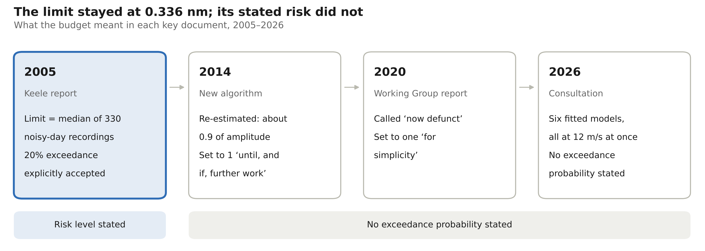
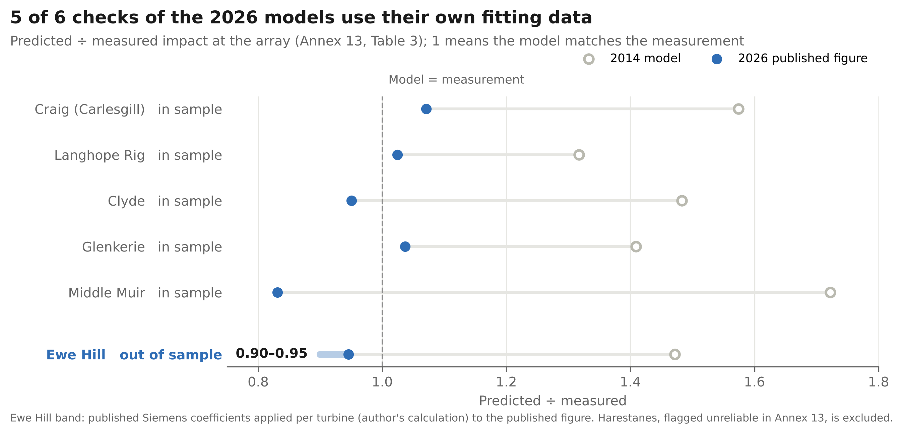
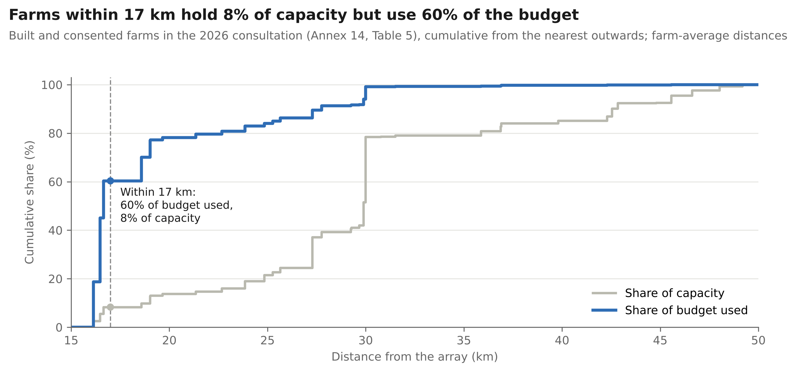

<div align="center">

# The budget that used to be a probability

**21 years of statistics at the Eskdalemuir seismic array**

An open, reproducible look at the 0.336 nm vibration budget that limits wind farms around the Eskdalemuir seismic array in southern Scotland, built entirely from public documents.

<br>

<a href="https://ridhimagupta4.github.io/eskdalemuir-budget/"></a>
<br>
<sub><a href="https://ridhimagupta4.github.io/eskdalemuir-budget/">ridhimagupta4.github.io/eskdalemuir-budget</a></sub>

<br><br>

<a href="LICENSE"></a>


</div>

---

## Contents

[Why this matters](#why-this-matters) ·
[Key findings](#key-findings) ·
[Interactive dashboard](#interactive-dashboard) ·
[Figures](#figures) ·
[Data](#data) ·
[Method](#method) ·
[Verification](#verification) ·
[Safeguards against statistical error](#safeguards-against-statistical-error) ·
[Limitations](#limitations) ·
[Reproduce](#reproduce) ·
[Repository layout](#repository-layout) ·
[Cite](#cite) ·
[Licence](#licence)

---

## Why this matters

The Eskdalemuir seismic array (EKA) is used by the UK Ministry of Defence to help verify the Comprehensive
Nuclear-Test-Ban Treaty. Wind turbines shake the ground, and within 50 km of the array their combined vibration
must stay under a fixed budget of **0.336 nm**. That budget decides how much wind power can be built across a
large part of southern Scotland and northern England.

When the budget was set in 2005 it came with a statistical meaning. It was the median of 330 half-hour
recordings taken on noisy days, and the report openly accepted that the limit would be exceeded about 20% of the
time. Over the next 21 years the number stayed the same but its meaning changed. By the UK government's July 2026
consultation it is checked with a deterministic model under a worst case: every turbine at 12 m/s at once, with
no exceedance probability stated.

This repository rebuilds the 2026 calculation independently and asks a statistician's questions of it. How much
of the budget is really used? Where is it used? How much is caution rather than measurement? How well checked is
the new model?

> **Article:** Ridhima Gupta (2026), *The budget that used to be a probability: 21 years of statistics at
> Eskdalemuir*. Link to be added on publication.

## Key findings

| | Finding | Value |
|---|---|---|
| **Use** | Budget still free, worst case as published (share of the squared budget, 1 − C²/B²) | **41.6%** |
| **Concentration** | Farms within 17 km of the array: share of capacity vs share of budget used | **8% vs 60%** |
| | Two farms (Hopsrig and Little Hartfell): share of budget used | **45%** |
| **Caution** | Shapley shares of three caution layers: known makers / utilisation / legacy allocations | **+4.9 / +8.4 / +16.3 points** |
| | Budget free with all three layers removed | **71.2%** (range 68.9 to 72.8) |
| **Validation** | 2014 model / measured, six Phase 4 farms | 1.32 to 1.72 |
| | 2026 published figure / measured, same six farms | 0.83 to 1.07 |
| | Comparisons that reuse the 2026 models' own fitting data | **5 of 6** |
| | Ewe Hill, the only out-of-sample check | 0.90 to 0.95 |
| **Reproduction** | Independent reproduction of the published cumulative amplitude | 0.2505 vs 0.2568 nm (−2.5%) |

The most cautious layer of all, the worst-case scenario itself, is not removed in any of these figures, because
estimating how often it happens needs wind data this project does not use.

**None of these figures is a recommendation to change the safeguarding regime.** They describe how the budget is
used and how much of that use rests on modelling choices.

## Interactive dashboard

<p align="center">
  <a href="https://ridhimagupta4.github.io/eskdalemuir-budget/"></a>
</p>

A single self-contained page with no external libraries, no tracking and no server. It runs the 2026 algorithm in
your browser.

| Panel | What you can do |
|---|---|
| **Where the budget goes** | Drag a distance cutoff and compare the budget used with the capacity held, farm by farm, with a top-10 table. |
| **The caution ledger** | Switch each layer of caution on or off. Set the utilisation factor (with exact presets for the current rule, the 2014 estimate and the 2005 rule) and the model-error allowance. Watch the free budget, headroom and implied SIL for 2 GW update. |
| **Single-turbine calculator** | Pick any of the six approved turbine models and set rotor, hub height, power and distance. See the predicted amplitude against the proposed SIL range. |
| **How well the new model is checked** | Predicted / measured at the Phase 4 farms, with in-sample and out-of-sample checks marked. |
| **What the budget meant, 2005 to 2026** | The change from a probability to a deterministic worst case, document by document. |

Every time it loads, the page recomputes 30 reference cases (6 turbine models × 5 geometries) and compares them
with the Python results. The badge at the top of the page shows whether they agree; the largest difference found
is 6 × 10⁻¹⁵. It also reproduces the government's Annex 15 known-case figures exactly (headroom 0.2303 nm, SIL 0.005150 nm/√MW).
It supports light and dark mode and works on phones.

**Offline:** download `docs/index.html` and open it in any browser.

## Figures

All four are computed from the data by `scripts/06_figures.py` and saved as PNG (300 dpi), PDF and SVG.

<table>
<tr>
<td width="50%"><br><sub><b>Figure 1.</b> The limit stayed at 0.336 nm; its stated risk did not.</sub></td>
<td width="50%"><br><sub><b>Figure 2.</b> Five of six checks of the 2026 models use their own fitting data.</sub></td>
</tr>
<tr>
<td width="50%"><br><sub><b>Figure 3.</b> Farms within 17 km hold 8% of capacity and use 60% of the budget.</sub></td>
<td width="50%"><br><sub><b>Figure 4.</b> Shapley shares of three layers of caution.</sub></td>
</tr>
</table>

## Data

Everything comes from public documents. The source documents are **not** redistributed. `data/README.md` gives
every URL, and `data/source_checksums.txt` gives the SHA-256 of every file used, so anyone can confirm they are
working from the same versions.

| File | Contents | Source |
|---|---|---|
| `annex14_table5.csv` | 112 built and consented farms: turbines, MW, mean distance, hub height, rotor diameter, amplitude, cumulative amplitude (worst case). Flags the six farms still calculated with the 2014 algorithm. | Annex 14, *The 2026 Algorithm*, Table 5 (DESNZ consultation, 7 July 2026) |
| `annex14_table6.csv` | The same farms, known-case scenario | Annex 14, Table 6 |
| `latt_coefficients_table7.csv` | Spectral coefficients of the six approved turbine models; 102 of 102 values identical in both sources | Annex 14 Table 7; Annex 5 Table 2 |
| `annex13_table3_measured_vs_2014.csv` | Measured impact at the array vs the 2014 model for seven farms, and which campaign fitted each 2026 model | Annex 13 (Phase 4 report), Table 3; Annex 5, Table 1 |
| `osm_turbines_50km.csv` | Turbine positions within 50 km (OSGB36), with the 12 validation farms labelled | OpenStreetMap, November 2026, © OpenStreetMap contributors, ODbL 1.0 |

Constants taken from other documents:

| Value | Source |
|---|---|
| Budget 0.336 nm | Styles et al. (2005), Keele University report for the MOD, DTI and BWEA |
| Headroom 0.216682 nm (worst case) and 0.230316 nm (known case) | Annex 15, *Headroom and SIL Calculations Explainer* (7 July 2026) |
| Utilisation estimate 82% (amplitude factor √0.82) | Xi Engineering (2014), FMB 203 (republished as Annex 12), Section 6.1 |

## Method

**1. Rebuild the 2026 algorithm** (`src/eskdalemuir/algorithm.py`), following Annex 14, Section 3. The steps:
- a source spectrum for each turbine model (broadband noise, four bending modes and blade-pass harmonics, scaled
  with wind speed cubed at hub height on a log wind profile);
- a frequency-distance weighting function made of the array's detection filter and a propagation term;
- integration over 0.5 to 8 Hz;
- a quadrature sum over turbines, √ΣA².

Constants come from Annex 14 Table 2 and coefficients from Table 7. Nothing is fitted.

**2. Measure use and concentration.** Using the published Table 5 amplitudes, the analysis works out the share of
the squared budget used, cumulated from the nearest farm outwards, and compares it with the share of installed
capacity.

**3. Build the caution ledger.** It looks at three layers of caution on top of measured behaviour:
- **K:** the known-maker scenario (Table 6) replacing the worst case (Table 5);
- **U:** the 2014 utilisation estimate;
- **L:** the six legacy farms put on the 2026 algorithm instead of their 2014 allocations.

Each layer's contribution is a Shapley value over all 2³ on/off combinations, so the result does not depend on the
order in which layers are removed.

**4. Check the validation.** It re-reads the government's model-vs-measured comparisons and labels which campaigns
were used to fit each 2026 model. That separates in-sample checks from out-of-sample ones.

## Verification

| Check | Result |
|---|---|
| Reproduction of the published cumulative amplitude (farm-average geometry) | 0.2505 vs 0.2568 nm, −2.5% |
| 12 validation farms, exact turbine positions from OpenStreetMap | median absolute error 3.4%, maximum 7.9% |
| Same 12 farms, farm-average geometry (as used for the legacy farms) | median absolute error 4.1%, range −8.2% to +6.8% |
| Sensitivity to the choices Annex 14 leaves open (α search band, channel count, integration rule) | changes the 12-farm median error by at most 0.26 percentage points |
| Second, independently written implementation (Simpson's rule, different grid) | agrees to better than 1 part in a million |
| Running quadrature of every farm row vs the published cumulative column | matches row by row (no row lost or misread) |
| Numbers printed in the article vs code (`scripts/05_article_numbers.py`) | 37 of 37 match |
| Dashboard engine vs Python, 30 cases | maximum difference 6 × 10⁻¹⁵ |

## Safeguards against statistical error

- **No tuning.** No parameter is fitted or adjusted to match a published figure. Published values are used only
  as comparison targets.
- **Published figures first.** The baseline and the known-maker layer use the government's own tables. The
  author's own calculations are used only where no published figure exists, which is the legacy layer.
- **Matching without the outcome.** The 12 validation farms were matched in OpenStreetMap by turbine count and
  mean distance only. Amplitudes were never used to match.
- **Uncertainty from other farms.** The band on the legacy layer comes from reproduction errors on the 12
  validation farms, computed the same way as for the legacy farms. It does not come from the legacy farms
  themselves.
- **Order-independent attribution.** Layer shares are Shapley values, and the code asserts that they sum exactly
  to the total change.
- **In-sample and out-of-sample kept apart.** Each validation comparison is labelled with the campaigns used to
  fit the 2026 models (Annex 5, Table 1). Harestanes, which the Phase 4 report flags as unreliable, is left out
  of the comparison and disclosed in the article.
- **Checked end to end.** A test suite and a number-by-number check fail loudly if any data, code or printed
  figure drifts.

## Limitations

These are stated plainly because they set how far the findings can be pushed.

1. **Public documents only.** The Ministry of Defence or its contractors may hold analyses, measurements or
   turbine data that are not public and would change some figures.
2. **Farm-average geometry.** Annex 14 gives each farm's mean distance, not every turbine's position, so an exact
   reproduction is not possible. On average the reproduction runs about 2% low.
3. **The largest layer is the least certain.** The legacy layer (+16.3 points) is the only one that rests on the
   author's own reproduction rather than a published figure. Its band, 13.7 to 18.0 points, reflects
   reproduction error only. It does not cover any difference between a farm's legal allocation and its modelled
   impact.
4. **Measured values include background noise.** Annex 13's measurements cannot fully separate turbine vibration
   from other sources, so public data cannot settle whether the 2026 models under-predict.
5. **Out-of-sample evidence is one farm.** Ewe Hill is the only check of the 2026 models against data they were
   not fitted to. One farm cannot establish the model's accuracy.
6. **The utilisation estimate is dated.** The 82% figure comes from 14 wind masts in 2008 and 2009. A factor of
   1 may be right if the dominant nearby farms tend to peak together.
7. **The worst case itself is not quantified.** No exceedance probability is estimated here. That needs
   long-run wind data (for example ERA5 or Met Office MIDAS) and is left for future work.
8. **Shapley is one convention.** Shapley values give a fair, order-independent split, but other attribution
   rules would divide the same total differently. The total (71.2%) does not depend on the convention.
9. **Scope.** Only built and consented farms in Annex 14 are covered, not projects in planning. OpenStreetMap
   positions are used only for validation geometry and may be incomplete.
10. **Not peer reviewed yet.** The code and numbers are open so that anyone can check them.

## Reproduce

Requires Python 3 (tested on 3.13) and about a minute.

```bash
git clone https://github.com/RidhimaGupta4/eskdalemuir-budget.git
cd eskdalemuir-budget
python -m venv .venv && source .venv/bin/activate      # Windows: .venv\Scripts\activate
pip install -r requirements.txt
pytest -q          # 11 tests
python run_all.py  # rebuilds every number, figure and the dashboard
```

| Script | Article section | Output in `outputs/` |
|---|---|---|
| `01_reproduce_algorithm.py` | Methods, Section 4 | reproduction of Table 5, 12-farm validation, sensitivity |
| `02_concentration.py` | Sections 1 and 5 | budget concentration by distance |
| `03_model_vs_measured.py` | Section 4 | predicted / measured, in-sample vs out-of-sample |
| `04_caution_ledger.py` | Section 5 | layer scenarios, Shapley shares, uncertainty band |
| `05_article_numbers.py` | All | checks every number printed in the article |
| `06_figures.py` | All | `figures/` (PNG 300 dpi, PDF, SVG) |
| `07_build_dashboard.py` | - | `docs/index.html` |

## Repository layout

```
eskdalemuir-budget/
├── data/          extracted tables, provenance (README.md) and source checksums
├── src/
│   └── eskdalemuir/   the 2026 algorithm (Annex 14, Section 3)
├── scripts/       01-07, run in order by run_all.py
├── tests/         pytest suite
├── outputs/       results (CSV, JSON)
│   └── figures/   the four figures (PNG, PDF, SVG)
├── dashboard/     template.html, the dashboard source
├── docs/          index.html, the built dashboard (GitHub Pages)
├── run_all.py
├── requirements.txt
├── CITATION.cff
└── LICENSE
```

Each folder has a `PLACEHOLDER.md` describing its contents.

## Cite

If you use this code or data, please cite it. GitHub's **Cite this repository** button reads `CITATION.cff`.

```bibtex
@software{gupta_2026_eskdalemuir,
  author = {Gupta, Ridhima},
  title  = {The budget that used to be a probability: code and data},
  year   = {2026},
  url    = {https://github.com/RidhimaGupta4/eskdalemuir-budget}
}
```

## Licence

- **Code:** MIT (see `LICENSE`).
- **Turbine positions:** © OpenStreetMap contributors, ODbL 1.0.
- **Extracted figures** from UK government consultation documents are reproduced for verification, with
  attribution. The consultation is published under the Open Government Licence v3.0 except where otherwise
  stated; some annexes are third-party reports. See `data/README.md`.

This is independent work. It is not endorsed by the Ministry of Defence, the Department for Energy Security and
Net Zero, the Eskdalemuir Working Group or the Royal Statistical Society.

<div align="center">
<br>
<a href="https://ridhimagupta4.github.io/eskdalemuir-budget/"></a>
</div>
